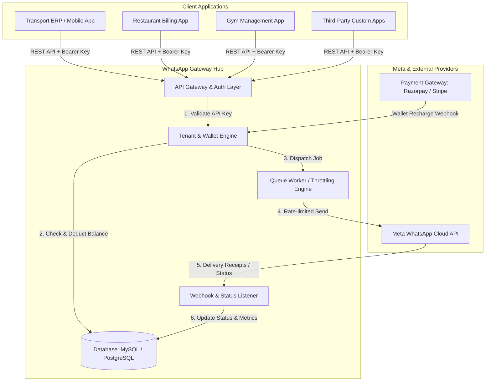

# 🚀 Multi-Tenant WhatsApp Gateway & Billing SaaS (Microservice)

## 📌 1. Project Overview
A standalone, high-performance, multi-tenant WhatsApp Messaging Hub. It provides a unified REST API for multiple client applications (**Transport ERP**, **Restaurant Billing**, **Gym Management**, and external third-party apps) to send automated WhatsApp messages, media, and PDF receipts with built-in **prepaid wallet management**, **per-message billing**, and **live delivery tracking**.

---

## 🏗️ 2. High-Level System Architecture



---

## 🗄️ 3. Database Schema Design

### 1. `tenants` (Accounts / Apps)
| Column | Type | Description |
| :--- | :--- | :--- |
| `id` | BIGINT (PK) | Unique tenant ID |
| `name` | VARCHAR(255) | Business / Tenant Name (e.g. *Spice Garden Restaurant*) |
| `app_type` | VARCHAR(100) | `transport`, `restaurant`, `gym`, `ecommerce`, `custom` |
| `api_key` | VARCHAR(64) (Indexed, Unique) | Secret key used for API requests (`gw_live_...`) |
| `secret_hash` | VARCHAR(255) | Hashed secret for webhooks & signatures |
| `per_msg_rate` | DECIMAL(8,4) | Default cost per message (e.g. `0.8000` INR) |
| `waba_id` | VARCHAR(100) | Optional dedicated WhatsApp Business Account ID |
| `phone_number_id` | VARCHAR(100) | Optional dedicated Phone Number ID |
| `status` | ENUM | `active`, `suspended`, `low_balance` |
| `created_at` | TIMESTAMP | Creation timestamp |

### 2. `wallets` (Prepaid Balance)
| Column | Type | Description |
| :--- | :--- | :--- |
| `id` | BIGINT (PK) | Unique wallet ID |
| `tenant_id` | BIGINT (FK) | References `tenants.id` |
| `balance` | DECIMAL(10,2) | Available credit balance in account currency |
| `currency` | VARCHAR(10) | Default: `INR` |
| `low_balance_threshold`| DECIMAL(10,2) | Balance threshold to trigger low credit warning |

### 3. `wallet_transactions` (Recharges & Usage Ledger)
| Column | Type | Description |
| :--- | :--- | :--- |
| `id` | BIGINT (PK) | Unique transaction ID |
| `tenant_id` | BIGINT (FK) | References `tenants.id` |
| `type` | ENUM | `credit` (recharge), `debit` (message sent), `refund` (failed send) |
| `amount` | DECIMAL(10,4) | Amount deducted or added |
| `balance_after` | DECIMAL(10,2) | Balance snapshot after transaction |
| `reference_id` | VARCHAR(255) | Message ID or Payment Gateway Order ID |
| `description` | VARCHAR(255) | E.g. *"Recharge via Razorpay"* or *"Message sent to 9876543210"* |
| `created_at` | TIMESTAMP | Transaction timestamp |

### 4. `message_templates` (Approved Meta Templates)
| Column | Type | Description |
| :--- | :--- | :--- |
| `id` | BIGINT (PK) | Unique template ID |
| `tenant_id` | BIGINT (FK, Nullable) | NULL for global templates, or specific tenant ID |
| `template_name` | VARCHAR(100) | Meta template name (e.g. `order_bill_receipt`) |
| `category` | ENUM | `UTILITY`, `MARKETING`, `AUTHENTICATION` |
| `language` | VARCHAR(10) | `en_US`, `hi_IN`, etc. |
| `body_preview` | TEXT | Sample template body with placeholders |
| `meta_status` | ENUM | `APPROVED`, `PENDING`, `REJECTED` |

### 5. `message_logs` (Live Message Audit & Delivery Tracking)
| Column | Type | Description |
| :--- | :--- | :--- |
| `id` | BIGINT (PK) | Unique log ID |
| `tenant_id` | BIGINT (FK) | Tenant who initiated the message |
| `recipient_phone` | VARCHAR(25) | Recipient mobile number in E.164 format (+91...) |
| `template_name` | VARCHAR(100) | Template used |
| `payload` | JSON | Parameters, dynamic variables & media URLs |
| `cost_charged` | DECIMAL(8,4) | Amount debited for this message |
| `status` | ENUM | `queued`, `sent`, `delivered`, `read`, `failed` |
| `meta_msg_id` | VARCHAR(255) | Meta WhatsApp Message ID |
| `error_details` | TEXT | Error code/message if delivery failed |
| `sent_at` | TIMESTAMP | Timestamp when dispatched |
| `delivered_at` | TIMESTAMP | Timestamp when recipient received |
| `read_at` | TIMESTAMP | Timestamp when recipient opened |

---

## 🔌 4. API Endpoints Specification

### A. Core Messaging API (For Client Apps)
- `POST /api/v1/messages/send-template`
  - Sends a standard utility/marketing template message.
  - Body:
    ```json
    {
      "to": "+919876543210",
      "template": "bill_receipt_pdf",
      "language": "en_US",
      "parameters": {
        "customer_name": "John Doe",
        "bill_no": "BILL-1092",
        "total_amount": "₹1,450.00",
        "pdf_link": "https://restaurant.com/receipts/1092.pdf"
      }
    }
    ```
- `POST /api/v1/messages/send-quick-text` (Direct non-templated text within 24h service window)
- `GET /api/v1/messages/{id}/status` (Check status of a single message)

### B. Wallet & Analytics API
- `GET /api/v1/wallet/balance` (Get available credits & recent usage)
- `POST /api/v1/wallet/recharge` (Create payment order for wallet top-up)
- `GET /api/v1/analytics/usage-summary` (Daily/Monthly message volume & breakdown)

### C. Webhook Receiver (From Meta)
- `GET /api/v1/webhooks/whatsapp` (Meta verification challenge handler)
- `POST /api/v1/webhooks/whatsapp` (Meta status callbacks: `sent`, `delivered`, `read`, `failed`)

---

## 🛠️ 5. Implementation Roadmap

```
Phase 1: Project Scaffolding & Database Setup (Now)
  ├── Setup backend service directory (whatsapp-gateway-service)
  ├── Initialize Node.js / Express or Laravel backend framework
  ├── Create environment configuration & database migration files

Phase 2: Wallet & Multi-Tenant Authentication Engine
  ├── Implement API Key verification middleware
  ├── Implement Atomic Wallet deduction & transaction ledger logic
  ├── Low-balance threshold protection (reject or alert)

Phase 3: Meta WhatsApp Cloud API Provider Adapter
  ├── Meta Cloud API client integration
  ├── Template formatter & parameter mapping
  ├── Webhook handler for delivery status tracking

Phase 4: Message Queue & Rate-Limiting Engine
  ├── Asynchronous message dispatcher (Redis / BullMQ / DB Queue)
  ├── Automatic refund mechanism on message failure

Phase 5: Client SDK & Integration Examples
  ├── Integration snippets for Transport ERP, Restaurant Billing & Gym Apps
  ├── Lightweight Admin Dashboard / Tenant Portal
```
